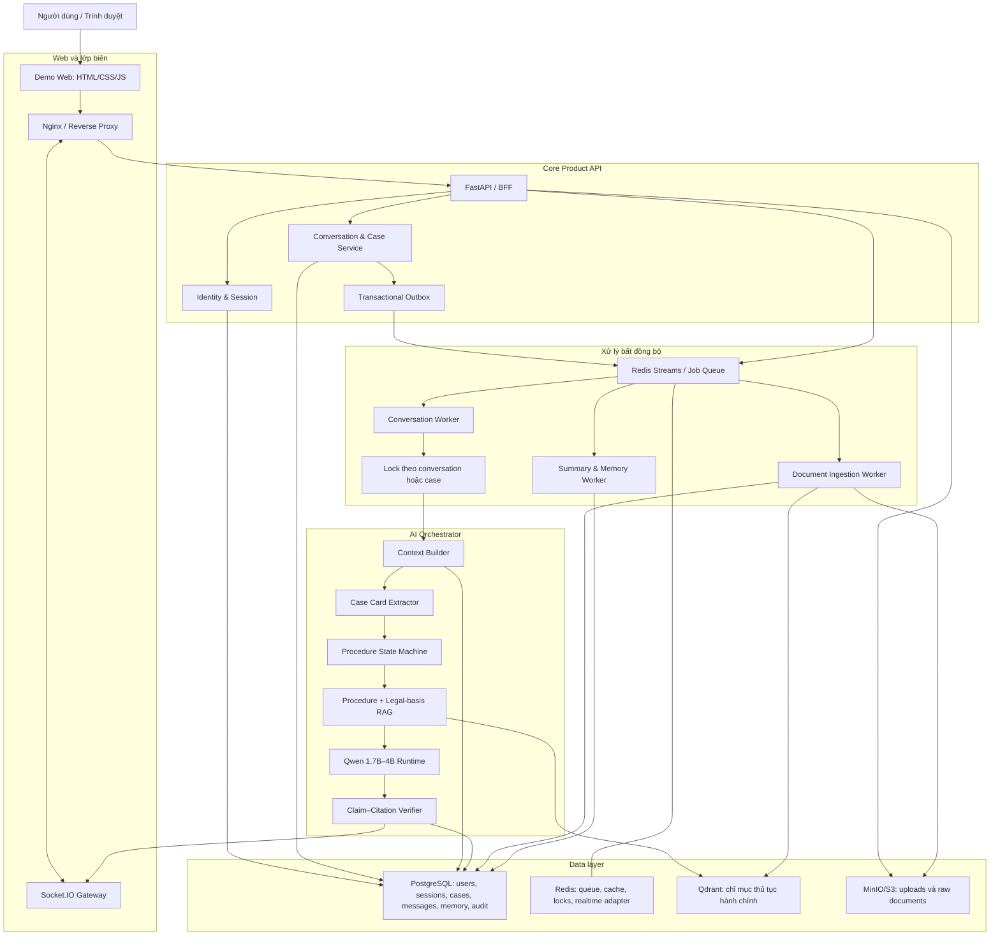
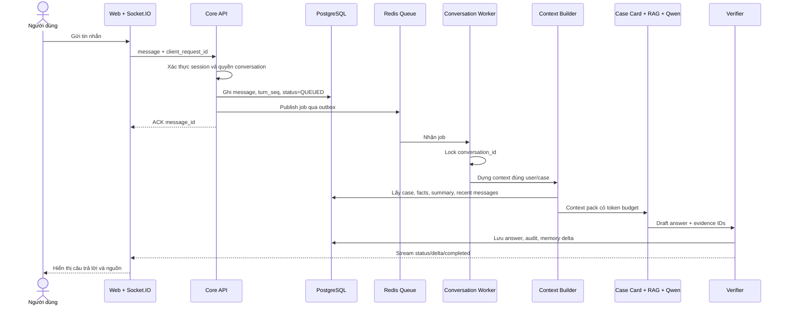

# Kiến trúc hệ thống – Trợ lý hành chính công “Luật Đúng Lúc”

> Bản phác thảo kiến trúc v0.1 từ nội dung họp ngày 07/09/2026.  
> Mục đích: dùng để thống nhất core product, phân chia công việc và bắt đầu dựng skeleton hệ thống.  
> Trọng tâm số một: **LLM tinh gọn, phản hồi chính xác, có căn cứ và giữ đúng ngữ cảnh từng người dùng qua nhiều ngày**.

---

## 1. Phân loại nội dung cuộc họp

| Nhóm | Yêu cầu đã ghi nhận | Cách đưa vào dự án |
|---|---|---|
| Core product | Giải đáp thắc mắc hành chính công và hướng dẫn quy trình | Đây là phạm vi sản phẩm chính, không phải một bước đệm cho chatbot toàn bộ pháp luật |
| Multi-user | Không lẫn ngữ cảnh giữa nhiều người | Mọi dữ liệu mang `tenant_id/user_id/conversation_id/case_id` và kiểm tra quyền ở backend |
| Identity | Cookie, hỏi tên và số điện thoại | Cookie chỉ chứa session token; số điện thoại phải OTP nếu dùng để đăng nhập |
| Long-term memory | Ngày hôm sau vẫn nhớ; lịch sử dài phải tóm tắt | Lưu raw message, case summary, structured facts và procedure state trong database |
| Multi-case | Ngày 1–5 làm CCCD, ngày 10–20 làm khai sinh | Tách thành hai `case_id`; không gộp thành một summary chung |
| Context understanding | Biết người dùng đang có giấy tờ gì và còn thiếu gì | Case Card + Procedure State Machine + RAG thủ tục hiện hành |
| Realtime | Socket.IO để nhận trạng thái và stream câu trả lời | Socket.IO là kênh realtime; database là source of truth |
| Queue | Tin nhắn vào hàng đợi và xử lý tuần tự | Tuần tự theo `conversation_id/case_id`, nhưng các cuộc hội thoại khác chạy song song |
| Backend | Core API LLM và API sản phẩm | FastAPI/BFF + Conversation Orchestrator + AI services |
| RAG upload | Upload tài liệu, index và xem trạng thái | Upload API → object store → ingestion queue → parser/indexer → activate version |
| Web demo | Chat, lịch sử, upload RAG, xem nguồn | Một dashboard gồm sáu khu vực chức năng |
| Deployment | Docker, `.env`, thông số kết nối | Docker Compose cho MVP; `.env.example` không chứa secret thật |
| Quality | Không chỉ đánh giá output cuối | Quality gate riêng cho identity, memory, Case Card, RAG, model, verifier và end-to-end |

## 2. Điều chỉnh phạm vi sản phẩm

Dự án không còn chỉ là một bài fine-tune LLM. Nó gồm ba lớp:

```text
LỚP SẢN PHẨM
Multi-user + định danh + lịch sử + hồ sơ thủ tục + giao diện

LỚP ĐIỀU PHỐI
API + queue + context builder + procedure workflow + Socket.IO

LỚP AI VÀ TRI THỨC
Case Card + Temporal RAG + Qwen + citation verifier
```

Phạm vi được chốt là **hỏi đáp và hướng dẫn thủ tục hành chính công**. Kho dữ liệu chính là thủ tục hành chính đã công bố: đối tượng, điều kiện, hồ sơ, các bước, cơ quan thực hiện, địa điểm/kênh nộp, phí, thời hạn, biểu mẫu, kết quả và phiên bản hiệu lực. Văn bản pháp luật chỉ là căn cứ hỗ trợ cho các thủ tục này; dự án không còn đặt mục tiêu giải đáp mọi lĩnh vực pháp luật Việt Nam.

## 3. Hai nguyên tắc không được hiểu sai

### 3.1. Qwen không tự nhớ người dùng

Qwen không được fine-tune bằng lịch sử riêng của từng người và không được nhét toàn bộ tin nhắn cũ vào context. Backend lưu dữ liệu, chọn phần liên quan rồi dựng context mới cho từng lượt.

### 3.2. “Tôi có CCCD” chưa cho biết mục tiêu

Nếu chưa có hồ sơ đang hoạt động, hệ thống phải hỏi:

> Bạn muốn thực hiện thủ tục nào liên quan đến CCCD?

Nếu người dùng đang ở hồ sơ đăng ký khai sinh, hệ thống có thể ghi nhận `documents_owned += CCCD`, sau đó dùng RAG để tính danh sách giấy tờ còn thiếu theo đúng địa phương và thời điểm. Không được tự suy ra “cần giấy khai sinh” chỉ từ câu “tôi có CCCD”.

### 3.3. Workflow tổng quát trước khi nhìn kiến trúc

Đây là luồng nghiệp vụ của toàn hệ thống. Qwen chỉ tham gia một số bước, không phải toàn bộ hệ thống.

```text
1. Nhận diện phiên/người dùng
   ↓
2. Nhận và lưu tin nhắn
   ↓
3. Xác định cuộc hội thoại và hồ sơ thủ tục đang hoạt động
   ↓
4. Dựng ngữ cảnh vừa đủ từ lịch sử, summary và facts đã xác nhận
   ↓
5. Qwen hiểu ý định và tạo/cập nhật Case Card
   ↓
6. Backend kiểm tra schema, dữ kiện còn thiếu và trạng thái hồ sơ
   ↓
7. Nếu thiếu dữ kiện quyết định → hỏi lại và tạm dừng
   ↓
8. Nếu đủ dữ kiện → RAG tìm đúng thủ tục theo địa phương, đối tượng và thời điểm
   ↓
9. Procedure Engine tính checklist, cơ quan thực hiện và bước tiếp theo
   ↓
10. Qwen diễn giải thành câu trả lời tự nhiên có evidence IDs
   ↓
11. Verifier kiểm tra giấy tờ, bước làm, cơ quan, thời hạn và nguồn
   ↓
12. Lưu câu trả lời + memory delta; stream kết quả về web
```

Trên đây là luồng phục vụ người dùng theo thời gian thực. Hệ thống còn một luồng quản trị tri thức độc lập:

```text
1. Admin upload/import dữ liệu công ty
→ 2. Kiểm tra định dạng, nguồn, checksum, quyền và PII
→ 3. Parse/chuẩn hóa thành procedure schema có phiên bản
→ 4. Review và phê duyệt
→ 5. Lưu Procedure Store + snapshot nguồn
→ 6. Chunk/embed/index vào RAG
→ 7. Chạy smoke test retrieval và regression test
→ 8. Publish phiên bản cho runtime sử dụng
```

Vì vậy, cập nhật thủ tục thường là cập nhật dữ liệu và index, **không phải train lại Qwen**. Fine-tune là pipeline riêng, chỉ chạy khi evaluation cho thấy model cần học một hành vi tổng quát tốt hơn.

Vai trò của từng khối:

| Khối | Làm gì | Không được làm gì |
|---|---|---|
| Web | Nhận câu hỏi, hiển thị lịch sử, hồ sơ, nguồn và trạng thái | Không tự quyết định user/case hay lưu secret |
| Backend/API | Định danh, phân quyền, lưu dữ liệu, điều phối workflow | Không giao quyền truy cập database trực tiếp cho LLM |
| Queue/Worker | Giữ đúng thứ tự và kiểm soát tải | Không để một người dùng chặn tất cả người khác |
| Context Builder | Lấy đúng memory của đúng user/case và giới hạn token | Không nhét toàn bộ lịch sử vào prompt |
| Qwen | Hiểu ngôn ngữ, trích xuất Case Card và diễn giải evidence | Không tự nhớ user, tự bịa thủ tục hay tự xác minh danh tính |
| Procedure Engine | So sánh facts với điều kiện/checklist có cấu trúc | Không dựa vào suy đoán tự do của model |
| RAG | Tìm phiên bản thủ tục và căn cứ chính thức | Không dùng lịch sử hội thoại làm nguồn hành chính chính thức |
| Verifier | Kiểm tra câu trả lời có được evidence hỗ trợ | Không thay thế cán bộ/chuyên gia ở ca vượt phạm vi |
| Database | Source of truth cho user, case, message, memory và audit | Không dùng cookie hay context window làm kho lưu trữ chính |

LLM vì vậy là **bộ máy hiểu và diễn đạt** nằm giữa Context Builder, Procedure Engine/RAG và Verifier. Tắt LLM thì hệ thống vẫn còn user, lịch sử, case, queue và kho thủ tục; nhưng mất khả năng hiểu câu hỏi tự nhiên và tạo câu trả lời mềm dẻo.

### 3.4. Ví dụ xuyên hai ngày

```text
Ngày 1 – Người dùng: “Tôi có CCCD.”
→ Backend nhận diện user nhưng chưa có active case.
→ Qwen không đủ thông tin để xác định thủ tục.
→ Hệ thống hỏi: “Bạn muốn thực hiện thủ tục nào?”

Người dùng: “Tôi muốn đăng ký khai sinh cho con ở phường X.”
→ Tạo case BIRTH_REGISTRATION.
→ Case Card ghi địa phương, vai trò và documents_owned=[CCCD].
→ Procedure Engine phát hiện các dữ kiện còn thiếu.
→ Nếu đủ, RAG lấy đúng phiên bản thủ tục tại phường/quận tương ứng.
→ Hệ thống trả checklist, nơi nộp, hình thức nộp và nguồn.

Ngày 2 – Người dùng quay lại sau khi đăng nhập.
→ Backend tải đúng case, facts, summary và bước đang dở.
→ Context Builder chỉ đưa phần liên quan vào Qwen.
→ Hệ thống tiếp tục từ bước còn thiếu, không bắt kể lại từ đầu.
```

---

## 4. Sơ đồ kiến trúc tổng thể



## 5. Luồng một tin nhắn



## 6. Định danh và cách ly nhiều người dùng

### 6.1. Hai chế độ

```text
Không đăng nhập
→ anonymous visitor_id
→ nhớ trên cùng trình duyệt bằng session cookie

Đăng nhập
→ tên hiển thị + số điện thoại + OTP
→ user_id chính thức
→ đồng bộ lịch sử qua nhiều thiết bị
```

Tên và số điện thoại nhập tay không đủ để xác minh đó là đúng người. Nếu cần khôi phục lịch sử xuyên thiết bị, phải xác minh OTP.

### 6.2. Cookie

Cookie chỉ chứa token phiên ngẫu nhiên, không chứa họ tên, số điện thoại, CCCD, lịch sử hay Case Card.

```text
Name: __Host-session
HttpOnly: true
Secure: true ở production
SameSite: Lax hoặc Strict
Path: /
```

Session token được hash trước khi lưu database. Cookie hết hạn hoặc bị thu hồi thì người dùng phải xác thực lại. Khuyến nghị này phù hợp với [OWASP Session Management Cheat Sheet](https://cheatsheetseries.owasp.org/cheatsheets/Session_Management_Cheat_Sheet.html).

### 6.3. Request context bắt buộc

Mọi request/job nội bộ phải mang:

```json
{
  "tenant_id": "tenant_uuid",
  "user_id": "user_uuid",
  "session_id": "session_uuid",
  "conversation_id": "conversation_uuid",
  "case_id": "case_uuid_or_null",
  "message_id": "message_uuid",
  "turn_seq": 42,
  "trace_id": "trace_uuid"
}
```

Backend không tin `user_id`, `case_id` hoặc `conversation_id` do frontend gửi nếu chưa kiểm tra ownership. PostgreSQL bật Row-Level Security hoặc cơ chế repository guard tương đương; khi bật RLS mà không có policy phù hợp, PostgreSQL áp dụng default deny. [PostgreSQL Row Security](https://www.postgresql.org/docs/current/sql-createpolicy.html)

---

## 7. Mô hình hội thoại và hồ sơ thủ tục

```text
User
├── Case 1: Cấp/cấp lại CCCD
│   ├── Conversation ngày 1–5
│   ├── facts đã xác nhận
│   └── trạng thái thủ tục
└── Case 2: Đăng ký khai sinh cho con
    ├── Conversation ngày 10–20
    ├── facts đã xác nhận
    └── trạng thái thủ tục
```

Các khái niệm:

- `Conversation`: luồng chat.
- `Case`: một hồ sơ/mục tiêu hành chính kéo dài qua nhiều ngày và có thể chứa nhiều conversation.
- `Case Card`: snapshot dữ kiện của case tại một thời điểm.
- `Procedure State`: bước hiện tại, giấy tờ đã có, dữ kiện thiếu và next action.

Khi phát hiện người dùng đổi chủ đề, hệ thống hỏi tạo hồ sơ mới hay tiếp tục hồ sơ cũ. Không tự trộn CCCD và khai sinh.

## 8. Bộ nhớ dài hạn

### 8.1. Sáu tầng bộ nhớ

1. `Raw messages`: lịch sử nguyên bản, lưu theo chính sách retention.
2. `Recent window`: vài lượt gần nhất.
3. `Case summary`: tóm tắt riêng từng case, có khoảng sequence đã bao phủ.
4. `Structured case facts`: giấy tờ đã có, địa phương, vai trò, các bước đã làm.
5. `User profile`: tên xưng hô, ngôn ngữ, địa phương mặc định khi đã đồng ý lưu.
6. `Procedure RAG`: thủ tục hành chính và căn cứ hỗ trợ đang có hiệu lực; không phải dữ liệu cá nhân.

Summary là bộ nhớ đệm, không phải nguồn sự thật. Mọi fact phải có `source_message_id` để truy ngược.

### 8.2. Context Builder

Không gửi toàn bộ lịch sử vào Qwen. Mỗi lượt chỉ ghép:

```text
System policy
+ Current user message
+ Active Case Card và facts đã xác nhận
+ Câu hỏi chưa giải quyết / next action
+ RAG evidence hiện hành
+ Recent message window
+ Relevant summary
+ Profile tối thiểu được phép dùng
```

Khi vượt ngưỡng token:

```text
summary(seq 1–20) + raw messages(seq 21 trở đi)
```

Summary cần lưu `covered_from_seq`, `covered_to_seq`, model version và source message IDs.

### 8.3. Memory delta

Qwen chỉ đề xuất thay đổi:

```json
{
  "case_id": "case_uuid",
  "add_facts": [
    {
      "key": "documents_owned",
      "value": "CCCD",
      "source_message_id": "msg_uuid"
    }
  ],
  "conflicts": [],
  "next_action": "ASK_PROCEDURE_INTENT"
}
```

Backend kiểm tra schema, allowlist field, provenance và conflict rồi mới ghi. Fact có trạng thái:

```text
EXTRACTED → USER_CONFIRMED
          → CONFLICT
          → SUPERSEDED
```

## 9. Procedure State Machine

Case Card chỉ chứa dữ kiện; Procedure State Machine quyết định luồng thủ tục.

```text
DETECT_INTENT
→ SELECT_OR_CREATE_CASE
→ EXTRACT_FACTS
→ CHECK_MISSING_DECISIVE_FACTS
→ RETRIEVE_CURRENT_PROCEDURE
→ BUILD_CHECKLIST
→ VERIFY_AUTHORITY_AND_CITATIONS
→ PRESENT_NEXT_ACTION
→ WAIT_FOR_USER_UPDATE
→ COMPLETED hoặc ESCALATED
```

Ví dụ state:

```json
{
  "procedure_code": "BIRTH_REGISTRATION",
  "jurisdiction": {
    "province": "TP.HCM",
    "ward": null
  },
  "documents_owned": ["CCCD"],
  "missing_decisive_facts": ["ward", "applicant_role"],
  "completed_steps": [],
  "next_action": "ASK_CLARIFICATION",
  "procedure_version_id": null
}
```

Danh sách giấy tờ còn thiếu không được lưu như chân lý vĩnh viễn. Nó được tính lại từ phiên bản quy trình RAG hiện hành.

---

## 10. Hàng đợi và xử lý tuần tự

### 10.1. Quy tắc đúng

```text
Conversation A: A1 → A2 → A3, bắt buộc tuần tự
Conversation B: B1 → B2, bắt buộc tuần tự

A và B được xử lý song song.
```

Không dùng một queue toàn cục khiến một người chặn tất cả người khác.

### 10.2. Chống trùng và đảo thứ tự

Mỗi message có:

```text
message_id
client_request_id
conversation_id
case_id
turn_seq
context_version
status
```

Unique constraint:

```text
(user_id, conversation_id, client_request_id)
```

Trạng thái:

```text
RECEIVED → QUEUED → PROCESSING → COMPLETED
                              ├→ FAILED
                              └→ CANCELLED
```

Worker nhận job theo cơ chế at-least-once nên xử lý phải idempotent. Redis Streams cung cấp ordered append-only log, consumer groups, acknowledgment và khả năng nhận lại job chưa ACK. [Redis Streams](https://redis.io/docs/latest/develop/data-types/streams/)

### 10.3. Transactional outbox

API ghi message và outbox event trong cùng transaction. Outbox publisher mới đưa job sang Redis. Cơ chế này tránh trường hợp DB đã lưu nhưng queue chưa nhận hoặc ngược lại.

Worker:

1. Lấy lock `conversation:{conversation_id}`.
2. Kiểm tra `turn_seq` tiếp theo.
3. Dựng context và chạy pipeline AI.
4. Ghi answer, audit và memory delta trong transaction.
5. ACK job sau khi commit.
6. Phát event realtime; nếu phát thất bại, client đồng bộ lại từ DB.

## 11. Socket.IO

Socket.IO dùng cho:

```text
message.ack
message.status
assistant.delta
assistant.completed
assistant.failed
history.sync
upload.status
```

Socket join room sau khi xác thực quyền:

```text
user:{user_id}
conversation:{conversation_id}
```

Socket.IO bảo đảm thứ tự event trên một kết nối nhưng mặc định chỉ bảo đảm giao tối đa một lần; ứng dụng phải tự persist event, ACK/retry và replay theo offset khi reconnect. [Socket.IO Delivery Guarantees](https://socket.io/docs/v4/delivery-guarantees)

Connection recovery hỗ trợ mất kết nối ngắn nhưng không luôn thành công, vì vậy frontend vẫn cần `last_event_seq` và REST `history.sync` để đồng bộ lại. [Socket.IO Connection State Recovery](https://socket.io/docs/v4/connection-state-recovery)

---

## 12. RAG và upload tài liệu

Đơn vị tri thức chính không còn là “một Điều luật”, mà là một phiên bản thủ tục hành chính có cấu trúc:

```text
procedure_code
procedure_version_id
service_domain
title
applicant_types
eligibility_conditions
required_facts
required_documents + conditions
steps
competent_authority
jurisdiction_rules
submission_channels
submission_locations
forms
fees
processing_time
result_type
legal_basis_ids
valid_from / valid_to
official_url
source_snapshot_id
```

Văn bản căn cứ vẫn được chunk theo Điều/Khoản/Điểm khi cần giải thích nguồn, nhưng kết quả chính của RAG là **procedure bundle** đầy đủ và đúng phiên bản.

```mermaid
flowchart LR
    A["Admin upload file"] --> B["Validate MIME, size, checksum"]
    B --> C["Malware scan + PII policy"]
    C --> D["MinIO raw immutable object"]
    D --> E["Ingestion queue"]
    E --> F["OCR / Parse / Normalize"]
    F --> G["Metadata + version/effectivity"]
    G --> H["Chunk thủ tục/bước/yêu cầu/căn cứ"]
    H --> I["BGE-M3 dense/sparse embeddings"]
    I --> J["Qdrant staging collection"]
    J --> K["Validation và sample review"]
    K --> L["Activate index_version"]
```



Upload có trạng thái:

```text
UPLOADED → SCANNING → PARSING → INDEXING → VALIDATING → ACTIVE
          └→ REJECTED     └→ FAILED
```

RAG không đọc collection staging. Chỉ `index_version` đã ACTIVE được dùng trả lời. Qdrant hỗ trợ dense và sparse vector, metadata filtering và multi-stage/hybrid queries; RRF là mặc định an toàn khi chưa có eval set để tune trọng số. [Qdrant Hybrid Queries](https://qdrant.tech/documentation/search/hybrid-queries/)

## 13. Core API đề xuất

### Identity và session

```text
POST   /api/v1/auth/anonymous
POST   /api/v1/auth/otp/request
POST   /api/v1/auth/otp/verify
POST   /api/v1/auth/logout
GET    /api/v1/me
DELETE /api/v1/me/data
```

### Conversation và case

```text
POST   /api/v1/conversations
GET    /api/v1/conversations
GET    /api/v1/conversations/{id}/messages
POST   /api/v1/conversations/{id}/messages
POST   /api/v1/cases
GET    /api/v1/cases
GET    /api/v1/cases/{id}
PATCH  /api/v1/cases/{id}/facts/{fact_id}/confirm
```

### Knowledge và upload

```text
POST   /api/v1/admin/uploads
GET    /api/v1/admin/uploads/{id}/status
GET    /api/v1/admin/indexes
POST   /api/v1/admin/indexes/{version}/activate
GET    /api/v1/evidence/{evidence_id}
```

### Realtime namespace

```text
/socket.io
```

Mọi mutation nhận `Idempotency-Key` hoặc `client_request_id`.

## 14. Data model tối thiểu

```text
users
sessions
otp_challenges
conversations
cases
messages
case_facts
case_summaries
memory_events
message_jobs
outbox_events
uploads
document_versions
index_versions
evidence_audits
access_audits
```

Quan hệ chính:

```text
User 1─N Sessions
User 1─N Cases
Case 1─N Conversations
Conversation 1─N Messages
Case 1─N CaseFacts
Case 1─N CaseSummaries
Upload 1─N DocumentVersions
IndexVersion 1─N Evidence fragments
```

## 15. Bảy khu vực web demo

MVP không cần bảy website riêng. Có thể làm một dashboard HTML/SPA với các route/tab sau:

1. **Identity & Consent:** phiên ẩn danh, tên hiển thị, số điện thoại/OTP và chính sách lưu lịch sử.
2. **Chat:** sidebar lịch sử + chat streaming + Case Card/checklist/evidence panel.
3. **My Cases:** hồ sơ đang làm/đã xong, giấy tờ đã có/thiếu và bước tiếp theo.
4. **My Documents:** upload cá nhân, trạng thái xử lý và quyền sử dụng/xóa.
5. **Memory & Privacy:** xem, sửa, xác nhận hoặc quên dữ kiện; xuất/xóa lịch sử.
6. **Knowledge Admin:** upload nguồn chính thức, metadata, version, index status và coverage.
7. **Operations & Evaluation:** queue lag, model/index version, latency, lỗi và KPI citation.

Để demo đẹp và dễ hiểu, bố cục chính:

```text
┌───────────────┬──────────────────────────┬──────────────────┐
│ Lịch sử/cases │ Chat + trạng thái xử lý  │ Case + Evidence  │
│               │                          │                  │
└───────────────┴──────────────────────────┴──────────────────┘
                     Upload/Admin là tab riêng
```

## 16. Docker topology cho MVP

| Container | Vai trò | Port development |
|---|---|---:|
| `web` | HTML/CSS/JS hoặc SPA | 3000 |
| `gateway` | Nginx | 8080 |
| `api` | FastAPI + REST | 8000 |
| `realtime` | Socket.IO ASGI | nội bộ hoặc 8002 |
| `worker` | Conversation/summary jobs | không public |
| `ingestion-worker` | Parse, chunk, embed | không public |
| `llm-server` | llama.cpp/vLLM OpenAI-compatible | 8001 nội bộ |
| `postgres` | App state và audit | 5432 nội bộ |
| `redis` | Queue/cache/lock | 6379 nội bộ |
| `qdrant` | Hybrid vector index | 6333 nội bộ |
| `minio` | File upload/raw store | 9000 nội bộ; console 9001 dev |

Production chỉ expose gateway qua HTTPS. Database, Redis, Qdrant, MinIO và model server ở private network.

## 17. Biến môi trường

File mẫu nằm tại `.env.example`. Nguyên tắc:

- Commit `.env.example`, không commit `.env` thật.
- Không đặt secret thật trong Dockerfile hoặc source code.
- Development có thể dùng `.env`; production dùng secret manager/Docker secrets.
- Validate toàn bộ config khi application startup và fail fast nếu thiếu.

Docker Compose có quy tắc precedence riêng cho biến môi trường; cần cố định cách chạy trong README để tránh máy mỗi người nhận config khác nhau. [Docker Compose environment variables](https://docs.docker.com/compose/how-tos/environment-variables/envvars/)

## 18. Đánh giá từng tầng mới

| Tầng | Quality gate |
|---|---|
| Identity | Không chiếm nhầm tài khoản; OTP flow đúng; session revoke được |
| Multi-user isolation | Cross-user/cross-tenant context leakage = 0 |
| Case routing | Chọn/tạo đúng case; macro-F1 và correct-resume rate |
| Memory extraction | Confirmed-fact precision/recall, unsupported-memory rate |
| Summary | Critical-fact retention, summary faithfulness, provenance coverage |
| Queue | Không đảo thứ tự, không mất/nhân đôi message, retry idempotent |
| Socket | Reconnect và replay đúng; không join room trái phép |
| Upload | File validation, index activation atomic và rollback được |
| Context builder | Context relevance, token budget và P95 latency |
| Case Card/RAG/Qwen | Dùng quality gates đã định nghĩa trong kế hoạch LLM |
| End-to-end | Grounded Joint Accuracy, correct-resume và task completion |

Các test bắt buộc:

- Hai người dùng hỏi đồng thời nhưng không lẫn dữ liệu.
- Một người dùng có hai case CCCD và khai sinh.
- Hai tab gửi cùng một message.
- Gửi hai message liên tiếp khi câu trước đang xử lý.
- Worker chết và job được retry.
- Socket mất mạng rồi reconnect.
- Summary bỏ sót hoặc bóp méo dữ kiện.
- Người dùng sửa lại một fact cũ.
- Cookie trên thiết bị dùng chung.
- Yêu cầu xem/xóa lịch sử.
- Upload chứa prompt injection hoặc file không hợp lệ.

## 19. Thứ tự triển khai

### P0 – Khóa kiến trúc và contract

- Chốt diagram, tech stack và ranh giới service.
- Khóa `RequestContext`, `Message`, `CaseCard`, `MemoryDelta`, `EvidenceBundle`, `ModelAnswer`.
- Chốt sáu khu vực web và API v1.
- Tạo `.env.example` và Docker Compose skeleton.

### P1 – Walking skeleton

- Anonymous session.
- Tạo conversation, lưu message PostgreSQL.
- Queue một worker, stream echo/mock response qua Socket.IO.
- Hiển thị lịch sử sau refresh/ngày hôm sau.

### P2 – Case và memory

- Case routing, Case Card và structured facts.
- Summary worker và context builder.
- Hai case độc lập cho cùng user.

### P3 – RAG và thủ tục hành chính

- Upload, ingestion, Qdrant và evidence panel.
- Procedure State Machine.
- BGE-M3 + reranker + temporal/applicability filter.

### P4 – Qwen và verifier

- Model server 1.7B/4B.
- Structured generation, citation audit và fail-closed.
- Component evaluation và end-to-end evaluation.

### P5 – Hardening

- Phone OTP, consent, retention và delete/export.
- Multi-worker, rate limit, retry/DLQ và observability.
- Security test, load test và deployment profile.

## 20. Definition of Done cho bản kiến trúc hôm nay

- Có sơ đồ tổng thể và sequence của một message.
- Phân biệt rõ user, session, conversation và case.
- Chốt cách lưu raw history, summary và structured memory.
- Chốt tuần tự theo conversation, song song giữa users.
- Chốt vai trò Socket.IO, Redis queue và PostgreSQL.
- Có luồng upload RAG.
- Có danh sách API, data entities, Docker containers và web sections.
- Có `.env.example` không chứa secret thật.
- Có danh sách quyết định còn mở để nhóm xác nhận với công ty.

## 21. Các quyết định cần hỏi công ty

1. Danh mục thủ tục hành chính nào phải có trong MVP và demo cuối?
2. Có yêu cầu đăng nhập bắt buộc không, hay cho phép phiên ẩn danh?
3. Có dịch vụ OTP nội bộ hay nhóm phải tích hợp nhà cung cấp ngoài?
4. Dữ liệu hội thoại được lưu bao lâu; người dùng có quyền xóa/xuất không?
5. Có được lưu số điện thoại và tài liệu cá nhân không; yêu cầu mã hóa thế nào?
6. Upload RAG dành cho admin hay từng người dùng được tạo kho riêng?
7. Số người dùng đồng thời, timeout và SLA latency mục tiêu?
8. Deployment tại máy công ty, cloud riêng hay máy cá nhân demo?
9. Có yêu cầu multi-tenant giữa nhiều đơn vị/cơ quan không?
10. Tài liệu thủ tục hành chính chính thức được cung cấp ở dạng nào và cập nhật ra sao?

## 22. Câu chốt kiến trúc

> **LLM không tự nhớ người dùng. Backend định danh và cách ly từng người, lưu lịch sử theo từng hồ sơ, tóm tắt có provenance, dựng context vừa đủ rồi mới gọi model. Mỗi conversation được xử lý tuần tự, nhiều conversation chạy song song; mọi câu trả lời hành chính phải dựa trên quy trình và nguồn đang có hiệu lực.**

## 23. Hướng tối ưu hóa sau nghiên cứu

Bản kiến trúc hiện tại là baseline đúng. Nghiên cứu tiếp theo đề xuất thêm ba contract logic trước khi triển khai sâu:

1. `Policy Router`: fast path cho fact update/câu hỏi field rõ; chỉ gọi Qwen và RAG đầy đủ khi cần.
2. `Evidence Gate`: kiểm phiên bản, phạm vi, facet và nguồn trước khi cho Procedure Engine tạo kết luận.
3. `AnswerPlan + ExpectedClaimSet`: backend render trực tiếp hồ sơ, phí, thời hạn, cơ quan và citation; Qwen chỉ diễn giải phần cần ngôn ngữ tự nhiên.

RAG cũng nên tách thành ba trách nhiệm:

```text
Procedure Resolver
→ map ngôn ngữ người dân sang procedure_id/version

Procedure Store/Engine
→ đọc trực tiếp các field chuẩn hóa và tính checklist

Evidence Retriever
→ lấy đoạn nguồn tương ứng để trích dẫn/kiểm tra
```

Chi tiết lý do, paper, mức ưu tiên và ma trận benchmark nằm trong `nghien-cuu-toi-uu-kien-truc-lightweight.md`.
