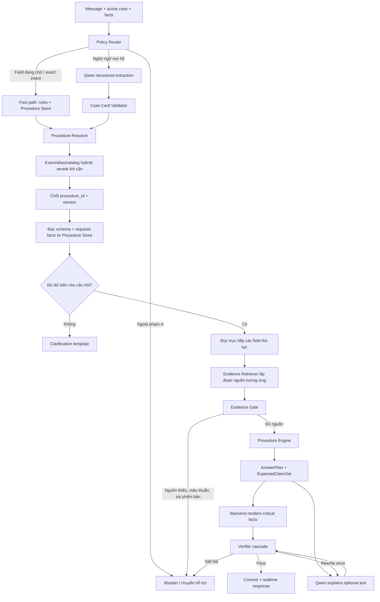

# Nghiên cứu tối ưu kiến trúc trợ lý hành chính công lightweight

> Ngày tổng hợp: 07/09/2026  
> Mục tiêu: tăng đồng thời độ chính xác, tốc độ phản hồi và số người dùng phục vụ được trên phần cứng giới hạn.  
> Phạm vi: Qwen 1.7B–4B, Procedure Store/RAG, Case Card, Procedure Engine, Verifier và hạ tầng inference.  
> Trạng thái: đề xuất nghiên cứu; mọi con số tốc độ cuối cùng phải đo lại trên RTX 5060 Ti 16GB và dữ liệu công ty.

---

## 1. Kết luận quan trọng nhất

Không có một kỹ thuật đơn lẻ giúp model vừa nhanh vừa đúng. Kiến trúc tốt nhất cho bài toán này là **đường xử lý thích ứng**:

1. Câu đơn giản đi qua rule, Procedure Store và template; có thể không cần gọi Qwen.
2. Câu mơ hồ gọi Qwen để trích Case Card bằng JSON Schema.
3. Truy vấn rõ ràng ưu tiên exact lookup và metadata filter.
4. Chỉ truy vấn khó mới chạy BM25 + dense retrieval + reranker đầy đủ.
5. Procedure Engine tạo `AnswerPlan` và `ExpectedClaimSet`.
6. Backend render trực tiếp giấy tờ, phí, thời hạn, cơ quan và bước làm.
7. Qwen chỉ bổ sung cách diễn đạt tự nhiên khi cần.
8. Evidence Gate và Verifier cho phép `ANSWER`, `CLARIFY`, `ABSTAIN` hoặc `ESCALATE`.

Phần tăng tốc lớn nhất có khả năng đến từ **giảm số lần gọi model, giảm token đầu vào/đầu ra và bỏ qua reranker khi không cần**, trước khi nghĩ đến speculative decoding hoặc model serving phức tạp.

## 2. Kiến trúc đề xuất v0.3



Ba khối nên thêm vào sơ đồ hiện tại:

- `Policy Router`: chọn fast path hay Qwen/RAG đầy đủ.
- `Evidence Gate`: quyết định bằng chứng có đủ và còn áp dụng không.
- `AnswerPlan + ExpectedClaimSet`: biến đáp án thành dữ liệu có thể kiểm tra trước khi diễn giải.

## 3. Policy Router: tránh gọi model cho mọi tin nhắn

### 3.1. Các route nên có

| Route | Ví dụ | Xử lý |
|---|---|---|
| `FACT_UPDATE` | “Tôi ở phường X”, khi hệ thống đang chờ phường | Rule/alias → validate → cập nhật fact |
| `SIMPLE_PROCEDURE_FACT` | “Lệ phí bao nhiêu?” khi đã biết procedure version | Procedure Store → template |
| `CLEAR_INTENT` | Nêu đúng tên/mã thủ tục | Exact lookup → validate |
| `AMBIGUOUS` | “Tôi có CCCD, còn thiếu gì?” nhưng chưa rõ case | Qwen structured extraction hoặc hỏi lại |
| `CASE_SPECIFIC` | Hỏi checklist theo hoàn cảnh cá nhân | Qwen extraction → RAG → Procedure Engine |
| `COMPLEX` | Cần phân biệt nhiều thủ tục hoặc nhiều điều kiện | Hybrid/multi-step retrieval có giới hạn |
| `OUT_OF_SCOPE` | Câu hỏi không thuộc hành chính công | Phản hồi theo mẫu/chuyển hỗ trợ |

Router MVP nên dùng các tín hiệu xác định được:

```text
active_case tồn tại?
procedure_code đã xác nhận?
backend đang chờ field nào?
message có khớp alias/format của field đó?
exact lookup có một kết quả rõ?
có conflict với fact đã xác nhận?
facet người dùng hỏi có trong Procedure Store?
```

Chưa cần train một router AI ở MVP. Sau khi có log và gold labels, có thể thử classifier nhỏ hoặc learned router. Adaptive-RAG cho thấy chọn chiến lược retrieval theo độ phức tạp có thể cân bằng chất lượng và chi phí, nhưng chính paper cũng cho thấy router vẫn nhầm nhiều giữa truy vấn one-step và multi-step; vì vậy phải đánh giá bằng dữ liệu hành chính của dự án. [Adaptive-RAG](https://arxiv.org/abs/2403.14403)

### 3.2. Không bỏ grounding ở fast path

Trong bài toán hành chính công, `FAST` không có nghĩa là dùng kiến thức trong weight của Qwen. Nó nghĩa là truy cập trực tiếp bản ghi Procedure Store đã được duyệt và render bằng template. Điều này giữ được phiên bản, nguồn và thẩm quyền mà không trả chi phí của một lượt generation.

## 4. Retrieval thích ứng thay cho một pipeline cố định

### 4.1. Pipeline đề xuất

```text
Procedure Resolver:
exact code/title/alias
→ metadata filter
→ hybrid sparse + dense nếu còn nhiều procedure candidates
→ reranker trên tập nhỏ khi cần
→ chốt procedure_id + procedure_version_id

Procedure Store/Engine:
đọc trực tiếp hồ sơ, điều kiện, bước, phí, thời hạn và nơi nộp theo ID đã chốt

Evidence Retriever:
lấy đúng đoạn nguồn/evidence_id tương ứng với từng field
→ Evidence Gate
```

BGE-M3 phù hợp để benchmark vì hỗ trợ dense, sparse và multi-vector trong một họ model, đồng thời có đánh giá đa ngôn ngữ và tiếng Việt. [M3-Embedding](https://aclanthology.org/2024.findings-acl.137/)

Một pipeline retrieval pháp lý tiếng Việt tại VLSP 2025 kết hợp BM25, dense retrieval, Qdrant và BGE reranker với hard negatives, cho thấy cấu trúc hai tầng retrieval → rerank là baseline hợp lý. Tuy nhiên cấu hình top-k trong paper không tự động là cấu hình tốt nhất cho dữ liệu thủ tục của công ty. [Vietnamese legal retrieval pipeline](https://aclanthology.org/2025.vlsp-1.17.pdf)

Điểm cải tiến lớn nhất so với RAG chung là **vector search chỉ chọn thủ tục và tìm citation; nó không quyết định phí, thời hạn hoặc giấy tờ**. Khi đã có active `procedure_id/version`, câu hỏi follow-up như “phí bao nhiêu?” có thể đọc thẳng field từ Procedure Store và lấy evidence theo `evidence_id`, bỏ global dense retrieval/reranker.

Một benchmark IR tiếng Việt 2026 trên nhiều miền cho thấy hiệu quả retrieval không được dự đoán tốt chỉ bằng kích thước model và tín hiệu lexical–semantic hybrid vẫn có giá trị rõ rệt. Vì vậy nhóm nên chọn retriever trên gold set hành chính, không chọn theo số tham số hoặc leaderboard chung. [Vietnamese IR across domains](https://aclanthology.org/2026.findings-eacl.110/)

### 4.2. Rerank động

Thay vì luôn rerank khoảng 50 candidates:

```text
Exact + metadata còn 1 record hợp lệ
→ bỏ reranker

Hybrid có top-1 rõ và đầy đủ facet
→ có thể bỏ reranker nếu vượt ngưỡng đã hiệu chỉnh

Nhiều thủ tục gần tên / khác địa phương / khác đối tượng
→ rerank top 10–20 trước

Ca khó
→ benchmark top 50
```

Ngưỡng không được lấy tùy ý từ model khác. Nhóm phải tune trên tập `procedure-routing-dev` và báo cáo `Recall@k`, `MRR`, top-1 accuracy, latency và tỷ lệ bỏ sót đúng thủ tục.

### 4.3. Bổ sung ngôn ngữ đời thường của người dân

Tên thủ tục chính thức thường khác cách người dân mô tả. Một nghiên cứu 2026 về gắn phản ánh của công dân với dịch vụ công tại Brazil dùng BM25 kết hợp dense retrieval trên các “RAG labels” được mở rộng bằng ngôn ngữ gần với người dân, và báo cáo cải thiện rõ so với khớp trực tiếp. Đây là bài toán gần nhất với bước nhận diện thủ tục của dự án. [Bridging Citizens and Public Services](https://aclanthology.org/2026.propor-1.13/)

Áp dụng thực tế:

```text
procedure_code
official_title
citizen_aliases
common_questions
common_misunderstandings
negative_aliases
```

LLM lớn có thể sinh candidate aliases offline; người có chuyên môn hoặc rule phải lọc trước khi index. Không để alias sinh tự động trở thành nội dung thủ tục chính thức.

### 4.4. Retriever nhỏ hơn cần benchmark

`gte-multilingual-base` là challenger đáng thử cho tốc độ: paper mGTE báo cáo text encoder/reranker cỡ base cạnh tranh với BGE-M3 lớn hơn và có hiệu quả inference tốt hơn trong các benchmark của họ. Kết quả đó chưa bảo đảm thắng trên tiếng Việt hành chính, nhưng đủ mạnh để đưa vào bake-off thay vì mặc định model retrieval lớn hơn sẽ tốt hơn. [mGTE](https://aclanthology.org/2024.emnlp-industry.103/)

Ma trận retrieval đề xuất:

```text
BGE-M3 dense + BM25 + bge-reranker-v2-m3
vs
gte-multilingual-base + BM25 + gte multilingual reranker
```

Tạm thời không cắt tùy ý embedding dimension của BGE-M3 vì model này không công bố được train theo Matryoshka. Chỉ thử giảm dimension với model có công bố hỗ trợ elastic/MRL, rồi đo lại Recall@k.

## 5. Procedure Store + rules vẫn là trục chính

Nghiên cứu compliance checking chỉ ra semantic embedding có tính khái quát nhưng có thể làm mất cấu trúc và logic; hướng kết hợp kho sự kiện/quy tắc với retrieval cho kết quả tốt hơn trong các benchmark của họ. Điều này ủng hộ thiết kế Procedure Store + Procedure Engine hiện tại. [Compliance Checking Framework](https://aclanthology.org/2025.coling-main.178/)

Procedure Engine nên xuất:

```json
{
  "procedure_version_id": "...",
  "route": "ANSWER",
  "required_documents": [],
  "conditional_documents": [],
  "missing_documents": [],
  "submission_place": {},
  "fees": [],
  "processing_time": {},
  "next_steps": [],
  "expected_claims": [],
  "evidence_coverage": {}
}
```

`documents_owned` do người dùng khai phải mang trạng thái `REPORTED`, không mặc định là `VERIFIED`.

## 6. AnswerPlan và backend rendering

Các giá trị dễ gây hậu quả nếu sai nên đi thẳng từ dữ liệu đã duyệt tới UI:

- Thành phần hồ sơ.
- Điều kiện và ngoại lệ.
- Phí/lệ phí.
- Thời hạn.
- Cơ quan và địa điểm/kênh nộp.
- Mã biểu mẫu.
- Citation và phiên bản.

Qwen chỉ tạo các đoạn ít rủi ro hơn, ví dụ lời mở đầu, giải thích ngắn hoặc liên kết các khối thông tin. `AnswerPlan` giúp giảm output tokens, làm verifier đơn giản hơn và loại nhiều lỗi “Qwen chép sai số”.

Một response có thể gồm:

```json
{
  "intro": "Bạn đã có CCCD. Với hồ sơ hiện tại...",
  "blocks": [
    {"type": "DOCUMENT_CHECKLIST", "rendered_by": "BACKEND"},
    {"type": "NEXT_STEPS", "rendered_by": "BACKEND"},
    {"type": "SHORT_EXPLANATION", "rendered_by": "QWEN"}
  ],
  "claim_ids": ["C1", "C2", "C3"]
}
```

Nếu không cần văn phong tự nhiên, đường template có thể trả lời mà không gọi Qwen lần hai.

## 7. Structured decoding cho Case Card và output

Qwen phải sinh Case Card bằng JSON Schema/grammar-constrained decoding. XGrammar thiết kế grammar engine có overhead end-to-end gần bằng không trong các cấu hình thử nghiệm và vLLM hỗ trợ structured outputs qua JSON Schema. Kỹ thuật này bảo đảm cú pháp/shape, không bảo đảm nội dung đúng. [XGrammar](https://arxiv.org/abs/2411.15100), [vLLM Structured Outputs](https://docs.vllm.ai/en/latest/examples/features/structured_outputs/)

Schema nên nhỏ, ổn định và cho phép `null/unknown`. Nếu bắt buộc mọi field có giá trị, grammar có thể vô tình ép model chọn một giá trị chưa có bằng chứng.

Output Case Card nên giới hạn khoảng 128–256 tokens. Answer tự nhiên nên mặc định ngắn, khoảng 300–600 tokens tối đa; UI cung cấp nút “xem chi tiết” khi cần.

## 8. Evidence Gate, Verifier và quyền không trả lời

Evidence Gate chạy trước generation:

```text
procedure_version còn hiệu lực?
đúng đối tượng / địa phương / cấp / kênh?
đủ facet người dùng đang hỏi?
có nguồn mâu thuẫn chưa giải quyết?
required facts đã đủ cho kết luận này?
```

Verifier chạy sau `AnswerPlan`/Qwen:

```text
1. Schema check
2. Exact-value check
3. Procedure/version/citation check
4. Completeness check
5. Conditional-rule check
6. Semantic entailment chỉ cho phần văn tự do còn lại
```

Không dùng duy nhất `confidence` do Qwen tự khai. Nghiên cứu selective QA cho thấy softmax confidence có thể kém khi gặp domain shift; một calibrator dựa trên lỗi thực nghiệm phù hợp hơn. [Selective QA under Domain Shift](https://aclanthology.org/2020.acl-main.503/)

Ngưỡng `ANSWER/ABSTAIN` nên dựa trên tập dev của công ty và đường `risk–coverage`:

- Coverage: hệ thống trả lời được bao nhiêu phần trăm câu hỏi.
- Selective risk: tỷ lệ sai trong phần hệ thống quyết định trả lời.

Abstain-R1 cho thấy model 3B có thể được huấn luyện để từ chối và hỏi làm rõ tốt hơn, nhưng đây là nhánh nghiên cứu sau khi rule/SFT baseline đã có. [Abstain-R1](https://aclanthology.org/2026.findings-acl.985/)

## 9. Giữ context ngắn dù model hỗ trợ rất dài

Qwen3-4B-Instruct-2507 là model 4B non-thinking và công bố context native 262K. Context tối đa không phải context nên dùng mặc định. [Qwen3-4B-Instruct-2507 model card](https://huggingface.co/Qwen/Qwen3-4B-Instruct-2507)

Nghiên cứu “Lost in the Middle” cho thấy độ chính xác có thể giảm khi evidence nằm giữa context dài, kể cả với model hỗ trợ long context. [Lost in the Middle](https://aclanthology.org/2024.tacl-1.9/)

Baseline nên đặt:

```text
typical input: 2K–6K tokens
hard cap ban đầu: 8K tokens
recent messages: theo token budget, không theo số message cố định
evidence: chỉ facet liên quan + nguồn cần thiết
raw history: PostgreSQL, không nhét vào prompt
summary: ngắn, có provenance, không dùng làm nguồn thủ tục
```

Nên đặt system policy + schema cố định ở đầu prompt; user/case/evidence thay đổi ở phần sau. Automatic Prefix Caching của vLLM tái sử dụng KV cache cho prefix giống nhau, giúp giảm phần prefill nhưng không làm decoding output nhanh hơn. [vLLM Prefix Caching](https://docs.vllm.ai/en/latest/design/prefix_caching/)

Trong môi trường nhiều người dùng, chỉ cache prefix công khai/cố định hoặc dùng `cache_salt` theo ranh giới tin cậy; không biến cache thành đường rò rỉ dữ liệu cá nhân. [vLLM OpenAI-compatible server](https://docs.vllm.ai/en/latest/serving/online_serving/openai_compatible_server/)

## 10. Serving và lượng tử hóa

### 10.1. Baseline runtime

Đề xuất hai nhánh benchmark qua cùng `ModelGateway` OpenAI-compatible:

| Nhánh | Dùng khi | Điểm chính |
|---|---|---|
| vLLM trong WSL2/Linux/Docker | Demo nhiều người dùng và production-like | PagedAttention, continuous batching, prefix caching, structured outputs |
| llama.cpp native Windows/CUDA | Demo đơn giản, GGUF, fallback | Dễ chạy local; benchmark Q5/Q4 trực tiếp |

vLLM không hỗ trợ Windows native; tài liệu chính thức hướng dẫn dùng WSL cho Windows. [vLLM GPU installation](https://docs.vllm.ai/en/latest/getting_started/installation/gpu/index.html)

PagedAttention giảm lãng phí KV-cache và tăng throughput trong các workload paper đánh giá. Mức tăng trong paper không được xem là lời hứa cho RTX 5060 Ti; phải đo lại theo context và concurrency của dự án. [PagedAttention/vLLM paper](https://arxiv.org/abs/2309.06180)

### 10.2. Quantization

Baseline chất lượng là BF16. Sau đó so sánh:

```text
BF16
Q8 hoặc FP8 nếu runtime/hardware hỗ trợ tốt
Q5_K_M GGUF
Q4_K_M GGUF hoặc AWQ INT4
```

AWQ giảm footprint và paper báo cáo tăng tốc trên các phần cứng/workload họ thử, nhưng 4-bit có thể làm giảm chất lượng. [AWQ](https://arxiv.org/abs/2306.00978)

Tài liệu Qwen/llama.cpp khuyến nghị dùng importance matrix với dữ liệu calibration đại diện miền khi quantize thấp; đây là lý do nhóm nên calibration bằng văn bản hành chính và hội thoại tiếng Việt. [Qwen llama.cpp quantization guide](https://github.com/QwenLM/Qwen3/blob/main/docs/source/quantization/llama.cpp.md)

Không chọn Q4 chỉ vì file nhỏ. Chọn cấu hình nhanh nhất vượt đồng thời:

- Case Card field F1 gate.
- Procedure/version accuracy gate.
- Critical value accuracy gate.
- Unsupported claim gate.
- Latency/VRAM/concurrency gate.

### 10.3. Continuous batching và queue

Queue vẫn phải tuần tự trong một conversation, nhưng worker cần chạy nhiều conversation song song để inference server continuous-batch. Nếu dùng một worker toàn cục chỉ xử lý một job tại một thời điểm, GPU sẽ rảnh và throughput thấp dù vLLM tối ưu tốt.

## 11. Cache nên dùng

| Cache | Key tối thiểu | Ghi chú |
|---|---|---|
| Procedure record | `procedure_version_id` | Dữ liệu công khai, invalidate khi publish version |
| Checklist | version + jurisdiction + applicant type + channel + relevant facts hash | Không cache nếu chứa dữ liệu cá nhân ngoài key/namespace an toàn |
| Retrieval result | normalized query + metadata filters + index version | Không dùng lại khi index version đổi |
| Embedding | normalized public query/text hash + embedding model version | Tránh encode lại nội dung công khai lặp lại |
| Prefix/KV | exact static prefix + model version + trust boundary | Chỉ giảm prefill |
| Final answer | Chỉ FAQ/template công khai, có procedure version | Không semantic-cache câu trả lời cá nhân giữa users |

## 12. Fine-tuning nào đáng làm

Ưu tiên `grounded SFT/QLoRA` với:

- Case Card và Memory Delta đúng schema.
- Hỏi đúng `missing_decisive_facts`.
- Phân biệt claim từ user với claim từ Procedure Store.
- Procedure bundle có positive evidence và hard negatives.
- Ca không đủ nguồn phải `ABSTAIN/CLARIFY`.
- AnswerPlan/claim IDs thay vì văn bản dài.

RAFT huấn luyện model trong môi trường open-book có distractor documents và citation, phù hợp để tham khảo cho grounded SFT. Không cần sao chép chain-of-thought hoặc coi kết quả trên PubMed/HotpotQA là bằng chứng trực tiếp cho hành chính Việt Nam. [RAFT](https://arxiv.org/abs/2403.10131)

Model lớn có thể làm teacher offline để sinh:

- citizen aliases và paraphrases;
- Case Card candidates;
- hard negatives;
- claim–evidence pairs;
- clarification questions;
- AnswerPlan candidates.

Mọi dữ liệu synthetic phải qua schema/rule/dedup và lấy mẫu review con người. Tri thức thủ tục thay đổi vẫn nằm trong Procedure Store/RAG, không nhồi vào weight.

## 13. Những kỹ thuật chưa nên đưa thẳng vào MVP

### 13.1. Speculative decoding

vLLM mô tả speculative decoding hữu ích nhất cho workload memory-bound ở QPS thấp/trung bình; hiệu quả phụ thuộc acceptance rate, phần cứng và tải. Một draft model còn dùng thêm VRAM. Với target 4B, nên tối ưu context/output/calls/batching trước, rồi benchmark n-gram/suffix hoặc EAGLE trên workload thật. [vLLM Speculative Decoding](https://docs.vllm.ai/en/latest/features/speculative_decoding/), [llama.cpp Speculative Decoding](https://github.com/ggml-org/llama.cpp/blob/master/docs/speculative.md)

### 13.2. Context compression bằng model

SARA 2026 cho thấy pure compression có thể bỏ mất chi tiết nhỏ quan trọng. Với hồ sơ, phí, số ngày và điều kiện, nhóm nên ưu tiên chọn đúng facet từ Procedure Store hơn là dùng một model tóm tắt evidence trọng yếu. [SARA](https://aclanthology.org/2026.acl-long.661/)

### 13.3. Learned model router/cascade

RouteLLM cho thấy router có thể chọn giữa model mạnh/yếu để giảm chi phí trên benchmark của họ. Với một GPU 16GB, việc giữ nhiều generator có thể làm giảm lợi ích do VRAM và worst-case latency. Chỉ thử sau khi rule router có baseline và công ty xác nhận có model lớn/remote fallback. [RouteLLM](https://arxiv.org/abs/2406.18665)

### 13.4. Small semantic verifier

Có thể benchmark MiniCheck hoặc một NLI model nhỏ cho phần văn tự do. Các kết quả công bố chủ yếu trên tiếng Anh/miền khác, nên chưa được đưa làm chốt chặn chính cho tiếng Việt hành chính. Rule/citation/exact-value verifier vẫn là tầng bắt buộc. [MiniCheck](https://aclanthology.org/2024.emnlp-main.499/)

## 14. Thứ tự triển khai đề xuất

### P0 — Làm ngay trong kiến trúc/MVP

1. Thêm `Policy Router` bằng rule.
2. Thêm `Evidence Gate`.
3. Thêm `AnswerPlan + ExpectedClaimSet`.
4. Critical facts do backend render.
5. JSON Schema constrained decoding cho Case Card.
6. Adaptive retrieval: exact/filter → hybrid → dynamic rerank.
7. Citizen aliases được review trong Procedure Store.
8. Context typical 2K–6K, hard cap 8K; output caps.
9. Cache theo procedure/index/model version.
10. Một model server dùng chung; concurrency giữa conversations.
11. BF16 baseline + telemetry từng stage.

### P1 — Benchmark sau khi walking skeleton chạy

1. BF16 vs AWQ/GGUF Q5/Q4 trên RTX 5060 Ti.
2. vLLM/WSL2 vs llama.cpp native Windows.
3. Rerank top 10/20/50 và ngưỡng skip reranker.
4. BGE-M3 vs `gte-multilingual-base`; sau đó mới so pretrained vs domain fine-tuned.
5. Grounded SFT/RAFT-style với hard negatives và abstention.
6. Semantic verifier tiếng Việt cho phần text tự do.
7. Classifier nhỏ thay rule router nếu log chứng minh cần.

### P2 — Chỉ làm khi benchmark cho thấy lợi ích

1. FP8 KV cache.
2. Speculative decoding.
3. Learned router giữa 1.7B/4B/model lớn.
4. Iterative/multi-hop RAG cho ca thật sự cần.
5. Aggressive context compression.
6. RL/RLVR cho clarification/abstention.

## 15. Ma trận benchmark trên RTX 5060 Ti 16GB

### 15.1. Model/runtime matrix

| ID | Runtime | Precision | Context | Concurrency |
|---|---|---|---:|---:|
| M0 | vLLM/WSL2 | BF16 | 2K, 4K, 8K | 1, 2, 4, 8 |
| M1 | vLLM/WSL2 | AWQ INT4 hoặc quant chính thức phù hợp | 2K, 4K, 8K | 1, 2, 4, 8 |
| M2 | llama.cpp/Windows | GGUF Q5_K_M | 2K, 4K, 8K | 1, 2, 4 |
| M3 | llama.cpp/Windows | GGUF Q4_K_M | 2K, 4K, 8K | 1, 2, 4 |

### 15.2. Pipeline ablation

| ID | Thay đổi so với baseline | Câu hỏi cần trả lời |
|---|---|---|
| A0 | Pipeline hiện tại luôn gọi Qwen + hybrid + rerank | Mốc đối chứng |
| A1 | + rule router/fast path | Giảm bao nhiêu model calls và p95? |
| A2 | + exact/filter/dynamic rerank | Có giữ retrieval recall không? |
| A3 | + AnswerPlan/backend rendering | Critical errors giảm bao nhiêu? |
| A4 | + prefix/procedure/retrieval cache | Warm latency và cache hit? |
| A5 | + grounded SFT | Chất lượng có tăng đủ để đáng train? |
| A6 | + semantic verifier | Bắt thêm lỗi hay tạo false reject? |

### 15.3. Tập test cần có

- Câu hỏi đơn giản đã biết case.
- Câu hỏi lần đầu nhưng nêu đúng tên thủ tục.
- Câu hỏi dùng tiếng đời thường.
- Câu hỏi cá nhân hóa theo địa phương/đối tượng/thời điểm.
- Câu hỏi thiếu decisive facts.
- Hai thủ tục gần tên.
- Evidence thiếu/hết hiệu lực/mâu thuẫn.
- Multi-turn và quay lại ngày hôm sau.
- Nhiều users/conversations đồng thời.
- Prompt injection trong message và file upload.

### 15.4. Metric bắt buộc

Chất lượng:

```text
route accuracy
Case Card field precision/recall/F1
procedure top-1 accuracy + Recall@k + MRR
correct procedure version / jurisdiction rate
conditional checklist accuracy
critical-value exact accuracy
supported-claim precision
citation coverage/correctness
clarification precision/recall
risk–coverage / abstention quality
end-to-end task success
```

Hiệu năng:

```text
model_calls_per_turn
input_tokens / output_tokens
queue_wait_ms
router_ms
retrieval_ms
rerank_ms
TTFT
TPOT / inter-token latency
end-to-end p50 / p95 / p99
requests per second
peak VRAM / RAM
cache hit rate
error / timeout / OOM rate
```

Mỗi kết quả tốc độ phải đi kèm kết quả chất lượng. Không chọn cấu hình nhanh hơn nếu làm tăng critical error hoặc unsupported claim vượt ngưỡng mentor/công ty chấp nhận.

## 16. Mục tiêu thử nghiệm, chưa phải cam kết SLA

Các mốc dưới đây dùng để định hướng benchmark ban đầu:

| Loại route | Mục tiêu trải nghiệm |
|---|---|
| Template/Procedure Store fast path | Phản hồi gần như tức thời sau API/DB lookup |
| Clarification route | Không chạy full RAG/generation nếu backend đã có mẫu hỏi |
| Standard personalized route | Ưu tiên prompt ngắn, một retrieval và tối đa hai lượt Qwen |
| Complex route | Cho phép chậm hơn nhưng phải hiện trạng thái xử lý và có timeout rõ |

Không nên chốt con số giây trước khi đo cold/warm, context length và concurrency trên chính RTX 5060 Ti.

## 17. Quyết định đề xuất cho nhóm

Chốt kiến trúc theo hướng:

```text
Qwen3-4B-Instruct-2507 non-thinking
+ rule-based Policy Router
+ versioned Procedure Store
+ adaptive hybrid RAG
+ Procedure Engine
+ AnswerPlan/backend rendering
+ Evidence Gate + deterministic Verifier
+ short context + cache + continuous batching
```

Không thay model ngay. Trước tiên hãy đo xem lỗi nằm ở routing, Case Card, retrieval, procedure rules hay diễn giải. Chỉ fine-tune/đổi model khi evaluation chứng minh bottleneck thuộc về model.

---

## Nguồn chính đã sử dụng

- [Qwen3-4B-Instruct-2507 model card](https://huggingface.co/Qwen/Qwen3-4B-Instruct-2507)
- [Qwen llama.cpp quantization guide](https://github.com/QwenLM/Qwen3/blob/main/docs/source/quantization/llama.cpp.md)
- [M3-Embedding / BGE-M3](https://aclanthology.org/2024.findings-acl.137/)
- [Vietnamese IR across domains, EACL 2026](https://aclanthology.org/2026.findings-eacl.110/)
- [mGTE multilingual retrieval, EMNLP 2024](https://aclanthology.org/2024.emnlp-industry.103/)
- [Vietnamese legal retrieval pipeline, VLSP 2025](https://aclanthology.org/2025.vlsp-1.17.pdf)
- [Bridging Citizens and Public Services, PROPOR 2026](https://aclanthology.org/2026.propor-1.13/)
- [Adaptive-RAG](https://arxiv.org/abs/2403.14403)
- [Compliance Checking Framework, COLING 2025](https://aclanthology.org/2025.coling-main.178/)
- [RAFT](https://arxiv.org/abs/2403.10131)
- [Lost in the Middle, TACL 2024](https://aclanthology.org/2024.tacl-1.9/)
- [SARA, ACL 2026](https://aclanthology.org/2026.acl-long.661/)
- [Selective QA under Domain Shift, ACL 2020](https://aclanthology.org/2020.acl-main.503/)
- [Abstain-R1, ACL 2026](https://aclanthology.org/2026.findings-acl.985/)
- [XGrammar](https://arxiv.org/abs/2411.15100)
- [vLLM Structured Outputs](https://docs.vllm.ai/en/latest/examples/features/structured_outputs/)
- [vLLM Prefix Caching](https://docs.vllm.ai/en/latest/design/prefix_caching/)
- [PagedAttention/vLLM](https://arxiv.org/abs/2309.06180)
- [vLLM Speculative Decoding](https://docs.vllm.ai/en/latest/features/speculative_decoding/)
- [RouteLLM](https://arxiv.org/abs/2406.18665)
- [MiniCheck](https://aclanthology.org/2024.emnlp-main.499/)
